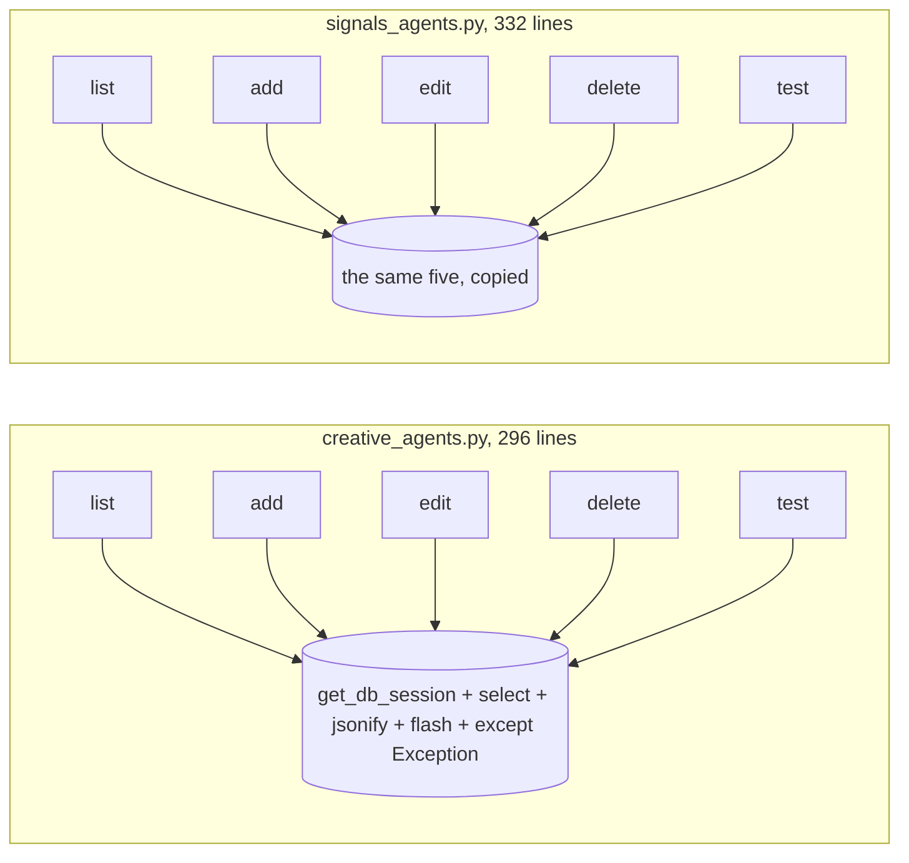
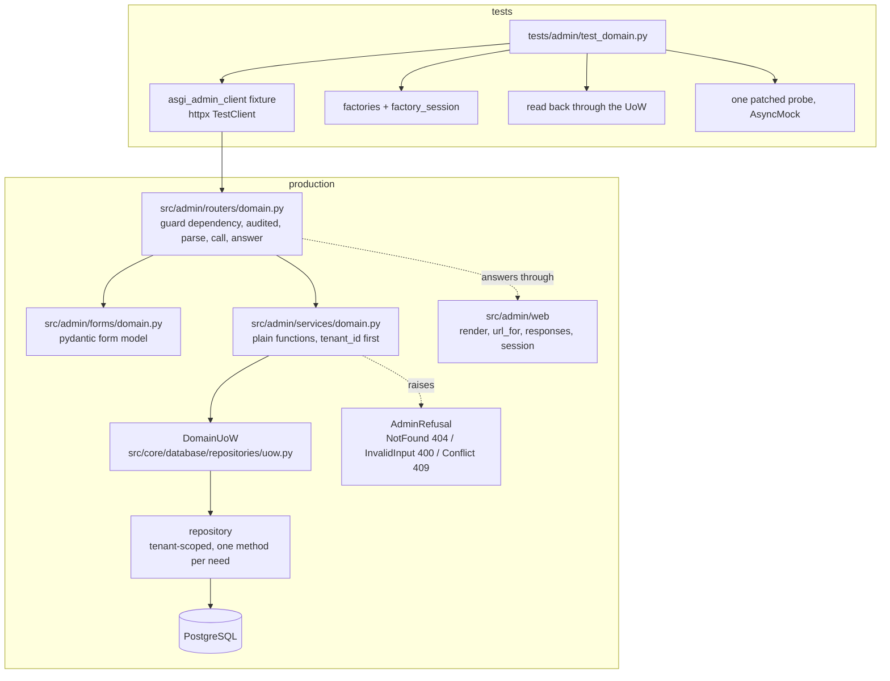
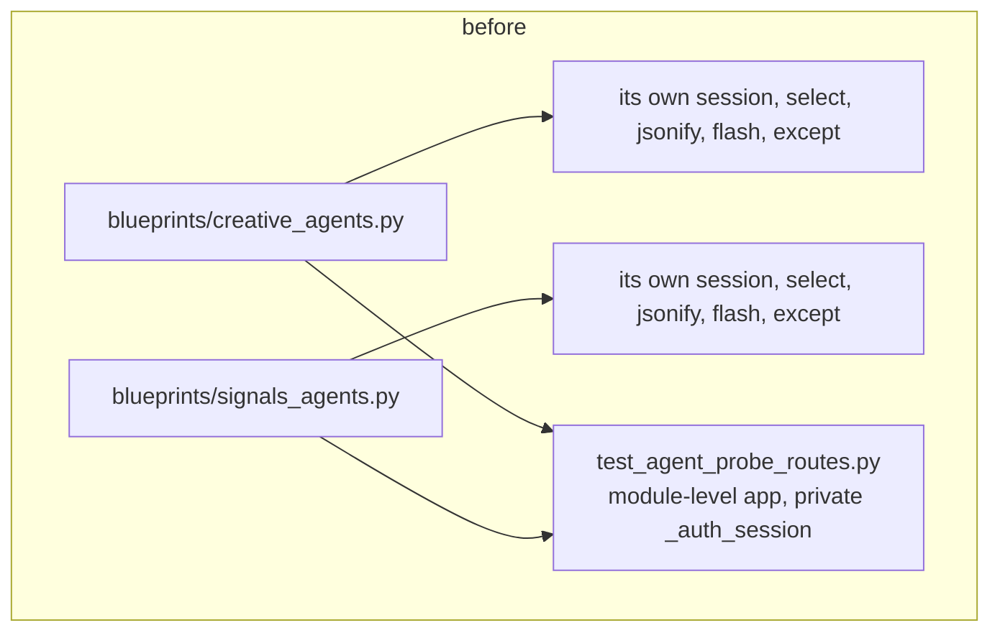
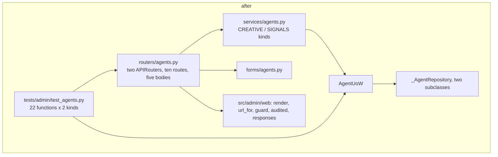
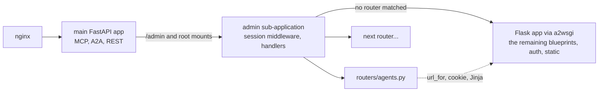
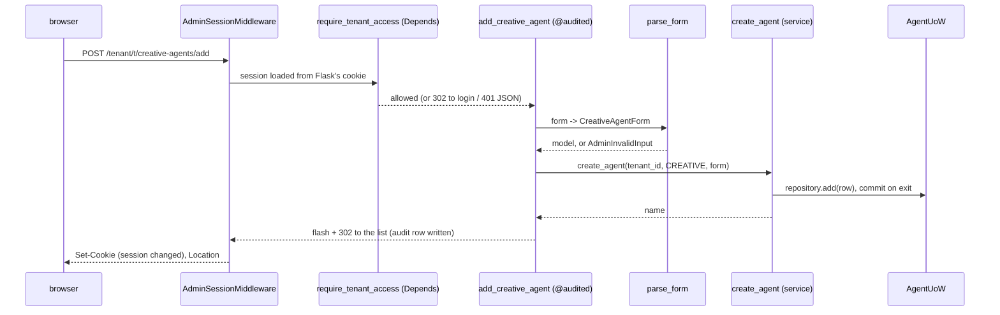
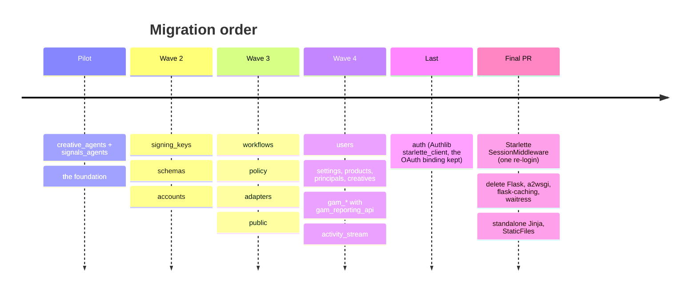

# Admin convention and ASGI migration: a proposal

This proposes one convention for admin routes and one mechanism for moving the admin panel from Flask into the FastAPI process the rest of the server runs in, shown on one real blueprint pair migrated on the draft pull request [v-n7k/salesagent#3](https://github.com/v-n7k/salesagent/pull/3) so the team can judge the rules on code. Nothing is enforced yet: the guards named under each rule are Phase 2, after this review.

## 1. The problem, measured

The admin panel has 28 Flask blueprints and no written rule for where business logic goes, how a route reads the database, validates input, answers, fails, or is tested. Counted at `c3bf1321`:

| What was counted | Count |
|---|---|
| Raw `get_db_session()` calls in `src/admin` (ratchet `.admin-raw-session-baseline`) | 186 |
| Raw `session.add()` in `src/admin` (same ratchet) | 39 |
| Admin rows in the raw-`select()` allowlist | 141 |
| JSON envelope shapes in use | 3 (242 / 85 / 35 sites) |
| Bare `except Exception` blocks in `src/admin` | 219 |
| Distinct input-validation styles | 5 |
| Routes that audit before they authorize | 54 |
| Private `_auth_session` copies in test modules | 10 |
| Module-level `create_app()` calls in `tests/admin/` modules | 14 |
| The pair, `creative_agents.py` / `signals_agents.py`: lines; raw sessions; selects; `jsonify`; `flash`; bare excepts | 296 / 332; 14; 18; 14; 30; 10 |

Every blueprint answers the questions its own way, so whoever adds a route, a person or an AI session, copies the nearest blueprint and inherits its habits. The pair in the last row is the clearest case: five routes written twice, drifting apart (one edit route validates before it assigns, the other after).

The second problem is the bridge: since [prebid/salesagent#1066](https://github.com/prebid/salesagent/pull/1066) the server is one FastAPI process serving MCP, A2A, REST and, through `a2wsgi`, the Flask admin. Counted at `1c202df2`:

| What was counted | Count |
|---|---|
| Modules importing `flask` under `src/admin` (plus two adapters) | 34 (+2) |
| Modules importing `fastapi` under `src/` | 4 |
| Flask route rules / blueprints / templates / `url_for` calls in templates | 229 / 31 / 59 / 138 |
| Path models that must agree (`root_path`, `SCRIPT_NAME`, `X-Forwarded-Prefix`), hence `script_name=` in every render | 3 |
| Thread-pool hops per admin request | 1 |

A convention written for a framework scheduled for removal would teach the team the rules twice. So the route layer is written for FastAPI from the start, and everything under it (forms, services, repositories, refusals) is framework-free, which makes each later migration a rewrite of one thin layer.



## 2. The convention in one picture

A router is a controller, the admin's twin of an AdCP `_impl`: the guard establishes the caller, the audit records the action, the form model types the input, one service call does the work, one helper answers.



## 3. The rules

Each rule: what it says, one measured reason, a before/after from the pilot's diff, the Phase 2 guard that will hold it.

### 3.1 Routers hold no data access

A route body renders values a repository returned, or parses the form and makes one service call. No `get_db_session()`, `select()`, ORM model import or `session.add()` in `src/admin/routers/`; a GET that renders rows opens the domain's Unit of Work and renders inside the block. Why: 186 raw sessions and 141 allowlisted selects in routes today, each a tenant-scoping decision made outside the repository that owns it.

```python
# before: blueprints/creative_agents.py
with get_db_session() as session:
    stmt = select(CreativeAgent).filter_by(id=agent_id, tenant_id=tenant_id)
    agent = session.scalars(stmt).first()
    if not agent:
        return jsonify({"error": "Creative agent not found"}), 404
    agent_name = agent.name
    session.delete(agent)
    session.commit()
    return jsonify({"success": True, "message": f"Creative agent '{agent_name}' deleted successfully"})
```

```python
# after: routers/agents.py
def _delete(request: Request, pages: _Pages, tenant_id: str, agent_id: int) -> Response:
    try:
        name = delete_agent(tenant_id, pages.kind, agent_id)
    except AdminRefusal as exc:
        return refuse_json(request, exc)
    return json_ok(message=f"{pages.kind.label} agent '{name}' deleted successfully")
```

Guard: `ruff-admin.toml` TID251 bans on the session factory, `sqlalchemy.select` and `src.core.database.models` for `src/admin/routers/**`, baseline zero; an AST test refusing `async def` there (the data layer is synchronous and would block the event loop). Route names keep today's `blueprint.endpoint` strings and every redirect `Location` is a `url_for` result, so templates do not change.

### 3.2 Services are plain functions, tenant first

`def <verb>_<noun>(tenant_id: str, ...) -> <typed result>`: one Unit of Work per call, data through its repositories, an `AdminRefusal` for what it cannot do, nothing caught, nothing imported from `flask`, `fastapi` or `starlette`. One function per operation; two routers that need it pass a parameter. Why: the pair's ten routes held the same five operations twice.

```python
# before: the add route, inline
agent = CreativeAgent(tenant_id=tenant_id, agent_url=agent_url, name=name,
                      enabled=enabled, priority=priority, auth_type=auth_type,
                      auth_credentials=auth_credentials)
session.add(agent)
session.commit()
```

```python
# after: services/agents.py, one function for both kinds
def create_agent(tenant_id: str, kind: AgentKind, form: AgentFormBase) -> str:
    raise_if_url_blocked(form.agent_url, _URL_LABEL)
    with AgentUoW(tenant_id) as uow:
        repository = _repository(uow, kind)
        row = repository.add(kind.model(tenant_id=tenant_id, **_fields(form)))
        return str(row.name)
```

Guard: TID251 on the three frameworks for `src/admin/services/**` and `src/admin/forms/**`, baseline zero.

### 3.3 Data access goes through a repository on a Unit of Work

Every read and write goes through a repository class reached from a `<Domain>UoW`; a repository that lacks a method gets the method; tenant scoping is the repository's job. Why: the pair's eighteen raw selects each spelled `tenant_id=tenant_id` by hand.

```python
# before
stmt = select(CreativeAgent).filter_by(id=agent_id, tenant_id=tenant_id)
agent = session.scalars(stmt).first()
```

```python
# after: one generic base, two one-line subclasses
class _AgentRepository[AgentRow: (CreativeAgent, SignalsAgent)]:
    def _tenant_rows(self) -> Select[Any]:
        return select(self._model).where(self._model.tenant_id == self._tenant_id).order_by(*self._ordering)

    def get(self, agent_id: int) -> AgentRow | None:
        return self._session.scalars(self._tenant_rows().filter_by(id=agent_id)).first()
```

Guard: the existing raw-select allowlist and raw-session ratchet, which only shrink (the pilot removes ten rows and fourteen sessions).

### 3.4 Input is validated one way

Every write route has a pydantic form model, built with one call from the submitted form. Types, defaults, required-ness and checkbox coercion live on the model, which declares exactly the fields its template submits, so an edit never resets a column the form does not carry. A failed validation is a refusal with today's wording: `"<Title> is required"`, else `"<Title>: <message>"`. Why: five validation styles today, and `int(request.form.get("priority"))` answered a typo with a generic "Error adding creative agent".

```python
# before
agent_url = request.form.get("agent_url", "").strip()
name = request.form.get("name", "").strip()
priority = int(request.form.get("priority", "10"))
if not agent_url:
    flash("Agent URL is required", "error")
    return redirect(url_for("creative_agents.add_creative_agent", tenant_id=tenant_id))
if not name:
    flash("Agent name is required", "error")
    return redirect(url_for("creative_agents.add_creative_agent", tenant_id=tenant_id))
```

```python
# after: forms/agents.py, and parse_form(CreativeAgentForm, form) in the router
class AgentFormBase(FormModel):
    agent_url: str = Field(title="Agent URL")
    name: str = Field(title="Agent name")
    enabled: bool = Field(default=False, title="Enabled")
    auth_type: str | None = Field(default=None, title="Auth type")
    auth_credentials: str | None = Field(default=None, title="Auth credentials")

class CreativeAgentForm(AgentFormBase):
    priority: int = Field(default=10, title="Priority")
```

The URL egress check stays in `src/admin/utils/url_policy.py`, called by the service that stores the URL. Guard: the existing egress rules.

### 3.5 One JSON envelope, one HTML path

JSON: `json_ok(**fields)` is `{"success": true, ...}`, `json_error(message, status)` is `{"success": false, "error": message}`. HTML: a successful write flashes one `success` and redirects (302, never 307) to the list; a refusal flashes one `error` and redirects back to the form; a GET renders. Why: three envelope shapes across 362 sites; the templates' JavaScript already reads `data.success` and `data.error`, so nothing breaks on this superset.

```python
# before: three shapes in one module
return jsonify({"error": "Creative agent not found"}), 404
return jsonify({"success": False, "error": result.message}), 400
return jsonify({"success": True, "message": result.message, "format_count": result.count})
```

```python
# after
return refuse_json(request, exc)            # {"success": false, "error": exc.message}, exc.status
return json_error(probe.message, 400)
return json_ok(**pages.kind.probe_fields(probe))
```

Guard: TID251 on `fastapi.responses` and `starlette.responses` outside `src/admin/web/`, baseline zero in routers.

### 3.6 Refusals are raised, failures propagate

`AdminRefusal` carries an operator-facing message and a status; `AdminNotFound`, `AdminInvalidInput`, `AdminConflict` bind the three codes. A router catches `AdminRefusal` and nothing else; an unexpected failure propagates, the audit decorator records it, and Starlette answers a plain 500 with no exception text. Why: 219 bare `except Exception` blocks, several putting `str(e)` into the browser.

```python
# before
except Exception as e:
    logger.error(f"Error testing creative agent: {e}", exc_info=True)
    return jsonify({"success": False, "error": f"Connection failed: {str(e)}"}), 500
```

```python
# after: the module's only except
try:
    probe = probe_agent(tenant_id, pages.kind, agent_id)
except AdminRefusal as exc:
    return refuse_json(request, exc)
```

Guard: ruff `BLE001` for `src/admin/**`, today's sites per-file-ignored, shrinking. First Phase 2 change: a 500 handler answering `json_error("Internal error", 500)` on JSON routes.

### 3.7 Guard before audit, structurally

The guard is a dependency on the route decorator; the audit is a decorator on the function. FastAPI resolves dependencies first, so an unauthenticated request never reaches the audited body. Every non-GET route carries `@audited`. The decision is the Flask decorator's, extracted into `tenant_access_decision`; the audit record is composed by one core in `audit_decorator.py`; both sides call both. Why: 54 routes audit before they authorize today, and neither delete route in the pair audited at all.

```python
# before: the audit wraps the guard
@creative_agents_bp.route("/add", methods=["GET", "POST"])
@log_admin_action("add_creative_agent")
@require_tenant_access()
def add_creative_agent(tenant_id):
```

```python
# after: the guard runs before the body the audit wraps
@creative_agents.api_route("/add", methods=["GET", "POST"],
                           name="creative_agents.add_creative_agent", dependencies=_PAGE)
@audited("add_creative_agent")
def add_creative_agent(request: Request, tenant_id: str, form: _FORM) -> Response:
    return _add(request, _CREATIVE, tenant_id, form)
```

Guard: an AST test over `src/admin/routers/**` failing on a non-GET route without `audited` or the guard dependency, baseline zero. JSON routes declare `api_mode=True`: an unauthenticated caller gets 401 JSON, not a login redirect.

### 3.8 Tests: one module per domain, shared fixtures, real database

`tests/admin/test_<domain>.py`, marked `admin` and `requires_db`; app and client from `tests/admin/conftest.py`; one session payload signed by the Flask app's serializer; data from factories; read-backs through the UoW; assertions on status, `Location`, the exact JSON body, the flash and the row. The only mock is the external dial. Why: 10 private `_auth_session` copies and 14 module-level apps today, and three old SSRF tests that patched the session factory graded the mock.

```python
# before: tests/admin/test_agent_probe_routes.py
app = create_app()

def _auth_session(client, tenant_id: str) -> None:
    with client.session_transaction() as sess:
        sess["authenticated"] = True
        sess["user"] = {"email": "test@example.com", "is_super_admin": True}
```

```python
# after: tests/admin/test_agents.py, parametrised over both kinds
@pytest.fixture
def client(asgi_admin_client, flask_app, tenant):
    asgi_auth_session(asgi_admin_client, flask_app, tenant.tenant_id)
    return asgi_admin_client

def _rows(case: _Case, tenant_id: str) -> list[tuple]:
    with AgentUoW(tenant_id) as uow:
        return [(row.name, row.enabled, ...) for row in getattr(uow, case.repository).list_all()]
```

Guard: an AST test failing on a module-level `create_app(` or a `def _auth_session` under `tests/`, allowlisting today's 14 and 10, shrinking. Tests follow their routes: the eight ingest-policy cases that drove the pair moved to the ASGI client, assertions unchanged.

## 4. The pilot

Before: two blueprints, 628 lines, each owning its copy of everything. After: one router module over one service, one repository family, one form module and one test module.





| Files | Before | After |
|---|---|---|
| Routes | `blueprints/creative_agents.py`, `blueprints/signals_agents.py` | [`routers/agents.py`](https://github.com/v-n7k/salesagent/blob/refactor/admin-convention-pilot/src/admin/routers/agents.py) |
| Logic, input shape, refusals | inline in the routes | `services/agents.py`, `forms/agents.py`, `errors.py` |
| Data access | raw `select` in the routes | `repositories/agent.py`, `AgentUoW` |
| Foundation | a2wsgi only | [`src/admin/web/`](https://github.com/v-n7k/salesagent/blob/refactor/admin-convention-pilot/src/admin/web) |
| Tests | `test_agent_probe_routes.py` (8) | [`test_agents.py`](https://github.com/v-n7k/salesagent/blob/refactor/admin-convention-pilot/tests/admin/test_agents.py) (42), `test_web.py` (19) |

Measured on `origin/main` and the branch (commands in the PR):

| Measure | Before | After |
|---|---|---|
| Lines, the pair's routes / the pair in full | 628 / 628 | 259 / 489 |
| Lines, the foundation (reused by every migration) | 0 | 549 |
| Raw sessions / `session.add` / selects / `jsonify` / `flash` / bare excepts | 14 / 2 / 18 / 14 / 30 / 10 | 0 / 0 / 0 / 0 / 2 / 0 |
| Admin raw-session ratchet | 186 / 39 | 171 / 37 |
| pylint R0801 duplicate blocks, `src/` / `tests/` | 25 / 42 | 25 / 42 |
| Flask blueprint modules | 28 | 26 |
| Tests for the pair | 8 | 42 |
| Private `_auth_session` / module-level `create_app()` in `tests/admin` | 10 / 14 | 9 / 13 |

Behavior changes, each a rule made visible: (1) audited routes audit inside the guard; (2) JSON 404 bodies gain `"success": false`; (3) unexpected failures answer a plain 500 without the exception text; (4) the creative test-connection route re-checks the stored URL against egress policy before dialing; (5) input is validated before any row is touched; (6) a refused write audits as a failure; (7) the four JSON routes answer 401 JSON when unauthenticated, not a login redirect; (8) both delete routes write an audit row; (9) a blank creative URL says "Agent URL is required", not the egress sentence; (10) a non-numeric `priority` or `timeout` flashes the field's own sentence; (11) text is trimmed, unknown fields ignored; (12) the Flask tenant guard no longer runs the view inside its own `try`, so a view's HTTP error keeps its status for tenant users; (13) the slashless list URL answers 404 where Flask answered a 308. The pull request lists each in full.

## 5. Migration

The mechanism is a strangler: a FastAPI sub-application mounted where the a2wsgi wrapper is today, at `/admin` and the root, with the Flask app mounted last inside it as the fallback; a path no router claims falls through to Flask as today. The session middleware reads Flask's signed cookie with Flask's serializer, so a login Flask's `auth` wrote is read by every router; `render` uses Flask's Jinja environment, so no template moves; `url_for` asks the routers first and Flask's `url_map` second, and in the other direction a build-error handler asks the routers. The reverse-proxy prefix is resolved once, with Flask's proxy-fix precedence.





Order, one blueprint per PR, smallest first:



Each migration PR carries the router, forms, service and tests (moved, assertions unchanged), deletes the Flask module and its `register_blueprint` line, and touches no template; a blueprint is never migrated inside an unrelated fix. Three ratchets make the direction one-way without forcing a date: the blueprint count (26), the raw-session baseline (171 / 37) and the duplication baseline (25 / 42), each only down.

## 6. Not in this proposal

This phase writes no guard, ratchet or `CLAUDE.md` rule (Phase 2, after your feedback), migrates no blueprint but the pair (Phase 3, after the guards), leaves `auth` for last, keeps Flask's cookie format until the final PR, adds no async database layer, touches no template, changes no URL, and opens no upstream PR until the team approves. It does not decide the authorization model: who may call which route is [prebid/salesagent#2256](https://github.com/prebid/salesagent/issues/2256); this proposal fixes the order of guard and audit and ports the decision unchanged.

What would make it a failure: a convention that only fits the pair; an unlisted change the operator sees; a big-bang rewrite, downtime, or a forced logout before the final PR; a migrated route at a different path; a new Flask blueprint after approval.

Three findings the pilot leaves alone: both edit forms echo the stored credential into the password input (`templates/creative_agent_form.html:72`, `templates/signals_agent_form.html:95`); two adapters import the UI framework (`src/adapters/gam_reporting_api.py:16`, `src/adapters/google_ad_manager.py:25`); no CSRF layer exists (`templates/base.html:6` renders `csrf_token()` only `if csrf_token`; nothing defines it).

## 7. Questions for the team

1. **Migration order.** Default: the waves above, smallest first, so wave 2 proves the convention on blueprints with no twin.
2. **Who migrates.** Default: a person or an AI session with this document as its brief; the Phase 2 guards make thirty mechanical PRs reviewable either way.
3. **Which prefix survives the final PR.** Default: both `/admin/...` and the root, because nginx composes three hosts from them and the proposal changes no URL. Only `/admin` would be one mount fewer and one nginx change.
4. **When to switch the session format.** Default: the final PR, one forced re-login, because until then Flask's `auth` writes the cookie every router reads.
5. **Async database.** Default: no. "ASGI everywhere" means one framework, not async I/O; repositories stay synchronous, endpoints stay `def`.

## 8. How to comment

Line comments on this file and on the pilot code are welcome on the draft pull request [v-n7k/salesagent#3](https://github.com/v-n7k/salesagent/pull/3). Its description's "Read in this order" list says where to start.
